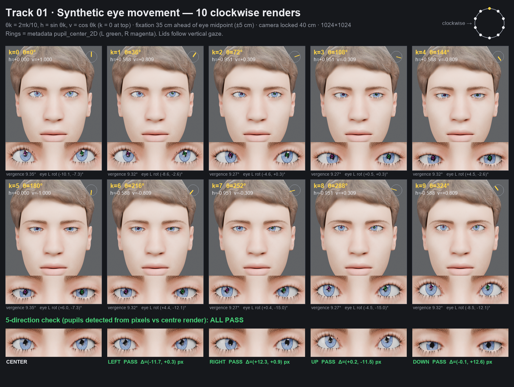

# Track 01 — Synthetic Eye Movement & Virtual Camera Rendering

A textured, rigged human face in Blender whose eyes rotate about their own physical centres, converge on a fixation target 35 cm in front of the eyes, and are rendered by a camera locked 40 cm in front. A small Python wrapper drives the gaze (`eyes.move(h, v)` / `eyes.reset()` / `eyes.render()`) and writes per-frame ground truth: 2D and 3D pupil centres, eye rotations, gaze vectors, and camera intrinsics/extrinsics.



## Bundle layout

```
team_name.zip
├── scene.blend            # textured MakeHuman mesh, eye bones, materials (textures packed)
├── wrapper/eyes.py        # eyes.move(h,v) / eyes.reset() / eyes.render()  (+ CLI)
├── renders/               # 10 clockwise frames frame_00..09.png, θk = 2πk/10
├── metadata.json          # one record per render
├── README.md
├── contact_sheet.png      # demo contact sheet
├── checks/                # centre/left/right/up/down/reset renders + verifier report
└── tools/                 # scene build, pupil calibration, verifier, contact sheet, pipeline
```

## Requirements

* **Blender 4.2 or newer.** Tested on Blender 5.2 LTS (Windows, RTX 4060, OptiX). No add-ons are needed to run the scene: everything is saved in `scene.blend`.
* For the optional verifier and contact sheet: Python 3.9+ with `numpy` and `Pillow` (`pip install numpy pillow`).

## Run it (what the evaluator runs)

From the bundle folder:

```bash
# 10 clockwise renders -> renders/frame_00..09.png + metadata.json
blender -b --factory-startup scene.blend -P wrapper/eyes.py -- --sequence

# 5-direction check renders -> checks/{center,left,right,up,down,reset}.png + checks/directions.json
blender -b --factory-startup scene.blend -P wrapper/eyes.py -- --directions

# a single pose
blender -b --factory-startup scene.blend -P wrapper/eyes.py -- --move -1 0 --out left.png
```

Options: `--samples N` (default 256; e.g. use 64 on a CPU-only machine), `--root DIR` (output folder; defaults to the folder that holds `scene.blend`). The wrapper uses GPU Cycles (OptiX → CUDA → HIP → oneAPI → Metal) when available and falls back to CPU. The render seed is fixed, so output is repeatable. Expect about 10 s per frame on an RTX 4060.

Or run everything, including the verifier and contact sheet, in one go:

```bash
python tools/pipeline.py            # render + verify + contact sheet
```

### Using the wrapper interactively (Blender Python console / Text Editor)

```python
import sys; sys.path.append(bpy.path.abspath("//wrapper"))
import eyes
eyes.move(0.5, -0.3)          # h, v in [-1, 1]; clamped
rec = eyes.render("//renders/test.png")   # renders and returns the metadata record
eyes.reset()                  # centre fixation
```

## Conventions

| Item | Value |
|---|---|
| `h`, `v` | normalised, in [-1, +1]. **+h = pupils move to image right** (the subject's left), **+v = up** |
| Fixation target | `T = M + 0.35 m·forward + (0.05 m·h)·right + (0.05 m·v)·up`, where M is the midpoint of the two eyeball centres. A Limit Location constraint enforces the ±5 cm bound |
| Camera | `CAM_Gaze`, transform-locked at `M + 0.40 m·forward`, looking back at the face; 85 mm lens on a 36 mm sensor; 1024×1024 PNG |
| Lighting | 3 fixed disk area lights + a constant grey world; nothing is animated |
| Clockwise sequence | θk = 2πk/10, k = 0..9, `h = sin θk`, `v = cos θk`. k = 0 is the top; k = 1 moves toward image right |
| World frame | Blender world, metres, Z up, face looks along −Y |

## How the rig works (calibration)

1. **Face**: generated with MPFB 2 (the MakeHuman add-on for Blender) using MakeHuman CC0 system assets: `young_caucasian_male` skin (Enhanced SSS shader), high-poly eyes with procedural iris material, eyebrows, eyelashes and short hair.
2. **True eyeball centres**: a least-squares sphere is fitted to the back (sclera) half of each eyeball mesh. Fitted radius is 15.09 mm. Each `eye.L`/`eye.R` bone's head is moved to that centre, and each eyeball gets 100% weight to its own bone. Rotation is therefore a rigid 3D spherical rotation about the physical centre, not 2D pupil sliding.
3. **Optical axis**: MakeHuman's eye is modelled slightly tilted (≈2.7° outward, 2° down). The axis is measured as the direction from the centre to the cornea bulge, and the bone is aligned to it. A **Damped Track** constraint then turns that axis toward `TGT_Fixation`, so both lines of sight pass exactly through the target and converge naturally. At rest the vergence is ≈9.4°.
4. **Entrance-pupil calibration** (`tools/calibrate_pupil.py`): the visible pupil is seen through the refracting cornea, so it is not the front-surface point. The script renders 13 catchlight-free gaze poses, detects the pupils from pixels, and fits a 3D pupil offset in the eye's local frame using Gauss–Newton. The result is 12.65 mm from the centre, about 3.7 mm behind the front surface, which is consistent with real eye optics. Reprojection RMS drops from 4.8 px to 2.2 px. The fitted offset is stored in `scene["gaze_cfg"]`.
5. **Lid–gaze coupling**: the upper and lower eyelid bones are driven by `k·atan(target_z / 0.35)`, with k = 1.0 for the upper lid and 0.5 for the lower lid. The lids follow vertical gaze as real lids do, so looking up does not bury the pupil. Horizontal gaze and convergence never move the lids.

## metadata.json (one record per render)

```jsonc
{
  "frame": 3, "theta": 1.885,
  "input": { "h": 0.9511, "v": -0.309 },
  "eye_rotation_L": [rx, ry, rz],          // deg, XYZ Euler, world frame, relative to the straight-ahead rest pose
  "eye_rotation_R": [rx, ry, rz],
  "pupil_center_2D_L": [x, y],             // px, origin top-left, as seen by the 40 cm camera
  "pupil_center_2D_R": [x, y],
  "camera_matrix": [[fx,0,cx],[0,fy,cy],[0,0,1]],   // intrinsics K (OpenCV convention)
  "camera_extrinsics_RT": [[...3x4...]],   // world -> camera (OpenCV: +Z forward, +Y down)
  "camera_projection_P":  [[...3x4...]],   // K [R|t]
  "gaze_vector_L": [...], "gaze_vector_R": [...],          // unit, world
  "pupil_center_3D_L": [...], "pupil_center_3D_R": [...],  // m, world
  "fixation_target_3D": [...], "vergence_deg": 9.27,
  "image": "frame_03.png"
}
```

`P · [pupil_center_3D, 1]` reprojects onto `pupil_center_2D` to within 0.09 px; the verifier checks this.

## Verification (`python tools/verify.py`)

This is an independent check that does not trust the metadata. Pupils are detected **from the PNG pixels** (the darkest disc-shaped blob in each eye, with catchlight holes filled) and compared against the centre render.

Latest run:

```
LEFT   PASS   L: dx=-11.61 dy=+0.28   R: dx=-11.77 dy=+0.25
RIGHT  PASS   L: dx=+12.54 dy=+1.26   R: dx=+12.02 dy=+0.46
UP     PASS   L: dx=-0.06 dy=-11.30   R: dx=+0.39 dy=-11.79
DOWN   PASS   L: dx=-0.25 dy=+12.77   R: dx=-0.01 dy=+12.40
RESET  PASS   L: dx=+0.00 dy=+0.00    R: dx=+0.00 dy=+0.00
=> 5/5 directions + reset pass
clockwise sequence: every frame's image-space pupil angle is within 6.2° of θk (both eyes)
metadata vs pixel-detected pupils: <= 2.9 px; camera model reprojection: 0.085 px
```

Results go to `checks/report.json`.

**Note on magnitude:** a ±5 cm target excursion at 35 cm is only about ±8° of eye rotation. That moves the pupil about 12 px in a 1024² face-framed render. The shift is clearly visible in the eye close-ups on the contact sheet, and it is exactly what the specified geometry produces.

## Rebuilding the scene from scratch (optional)

`scene.blend` ships prebuilt. To regenerate it:

1. Install the **MPFB** extension (2.0.18) in Blender: *Edit → Preferences → Get Extensions*, search "MPFB".
2. Install the **MakeHuman CC0 system assets** pack: download `makehuman_system_assets_cc0.zip` from `files.makehumancommunity.org/asset_packs/makehuman_system_assets/` and load it via *MPFB → Apply assets → Library settings → Load pack from zip*.
3. Run `python tools/pipeline.py --all`. This builds the scene, calibrates, renders, verifies and makes the contact sheet.

## Assets & licences

* MakeHuman base mesh, skin, eyes, eyebrows, eyelashes and hair: **CC0** (MakeHuman system assets).
* MPFB (GPL-3.0) is used only as a generator at build time. It is not needed to open or render `scene.blend`.
* All code in `wrapper/` and `tools/` was written for this submission.
