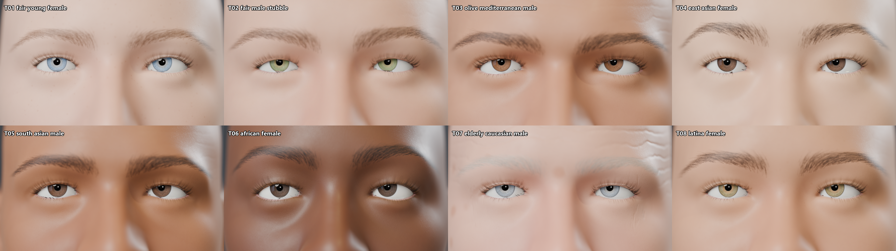

# Synthetic Eyes on GNM: photoreal textures and natural eye motion

**Samsung PRISM Hackathon 2026, XR Perception Group, Track 1**<br>
Team Rocklef: Sree Rohith Balaji and Thackshanaramana, SRM Institute of Science and Technology

Everything is built on **Google's GNM v3 head model** and wraps directly onto GNM's topology and UV layout.



## Deliverables (one per rubric item)

| # | Rubric item | Points | Deliverable | Where |
|---|---|---|---|---|
| 1 | **Texture photorealism** | 60 | 8 textured UV sets on **GNM's UV layout**, covering face and eyes | [`textures/`](textures/) |
| | | | Python script that renders with the generated textures | [`render_textures.py`](render_textures.py) |
| | | | Renders with different textures (8 sets × portrait / both eyes / macro) | [`renders_textures/`](renders_textures/) |
| 2 | **Kinematic accuracy** | 20 | Python script with 3 inputs (Left / Right / Generate Motion) that renders frames and makes a video | [`eyes_cli.py`](eyes_cli.py) |
| | | | A video for each input, each 15 s or less | [`renders_eyes_cli/`](renders_eyes_cli/) |
| 3 | **Code & UV portability** | 20 | `.blend` that loads the GNM head and animates an expression on the Timeline (eyelids, iris/pupil, eyebrows, gaze) | [`gnm_expression_timeline.blend`](gnm_expression_timeline.blend) |

## 1. Textures (GNM UV, UDIM)

Each set is `textures/<ID>_<name>/<ID>_{albedo,normal,roughness}.<UDIM>.png`:

| Tile | Region | Maps |
|---|---|---|
| 1001 | Skin (face, scalp, ears, neck, lid margins) | albedo, normal, roughness, all 4096² |
| 1002 | Left eye: sclera, iris, pupil | albedo + iris relief normal, 4096² |
| 1004 | Right eye: a **separate** iris (same colour family, different pattern) | albedo + iris relief normal, 4096² |
| 1006, 1007 | Teeth and gums, tongue | albedo |

In Blender, load `<ID>_albedo.<UDIM>.png` as a tiled image on GNM's UV map, and every region gets its texture.

| ID | Set | Iris |
|---|---|---|
| T01 | fair, young female | blue |
| T02 | fair male, stubble | green |
| T03 | olive / Mediterranean male | brown |
| T04 | East Asian female | dark brown |
| T05 | South Asian male | dark brown |
| T06 | African female | very dark |
| T07 | elderly Caucasian male, wrinkles and age spots | grey-blue |
| T08 | Latina female | hazel |

**Skin**
- **Seam-free by construction.** Every skin layer is generated in 3D on the GNM surface and baked through GNM's own
  UVs, so the texels on either side of a UV seam come from the same 3D point.
- **Layers:**
  - melanin tone and mottling, plus haemoglobin redness on the nose, cheeks and ears
  - under-eye shadow and a wet pink waterline
  - vermilion lips with fine lines
  - pores at about 0.4 mm, stronger in the T-zone
  - freckles and age spots
  - stubble and scalp follicles
  - forehead lines and crow's feet that scale with age
- **Region masks** come from GNM's own vertex groups.
- **Eyebrows.** About 900 individual hairs per brow, grown with an anatomical flow field (upward at the inner end,
  herringbone through the body, outward at the tail).

**Eyes** (4K, separate for each eye)
- Domain-warped stroma fibres with raised trabeculae, plus a matching relief normal map
- Crypts of Fuchs, contraction furrows, a zig-zag collarette ridge and a crenellated pupillary ruff
- Pigment flecks and a soft limbal ring
- Sclera with a blue-grey limbus, warm canthi and branching conjunctival vessels

**Rendering**
- Cycles, with refraction through GNM's cornea and a pupil that traps light.
- A soft lid shadow on the eyeball.
- A tear-film strip on the lid margins.
- Clumped, curled eyelashes bound to the lids.

**Faces**
- Each set is rendered on a matching GNM identity from GNM's official semantic IdentitySampler, which we ported to
  NumPy.
- [`renders_textures/same_head/`](renders_textures/same_head/) shows all 8 sets on one identical head, proving the
  maps are interchangeable on GNM's UVs.

## 2. Eye motion: `eyes_cli.py`

```bash
python eyes_cli.py --input left      # both eyes move left, naturally            -> renders_eyes_cli/eyes_left.mp4
python eyes_cli.py --input right     # both eyes move right                      -> renders_eyes_cli/eyes_right.mp4
python eyes_cli.py --input motion    # natural sequence incl. an upward eye-roll -> renders_eyes_cli/eyes_motion.mp4
```

Options: `--tex T01..T08`, `--res 1920x1080`, `--samples 48`, `--fps 30`, `--blender PATH` (or env `XR_BLENDER`).
Directions are from the viewer's side.

What makes the motion look human ([`gnm_rig/motion.py`](gnm_rig/motion.py)):
- **Saccades** follow the main sequence (21 ms + 2.2 ms/°) with a minimum-jerk profile.
- **Fixations** have drift and micro-saccades.
- **Blinks** close fast (about 90 ms) and reopen more slowly (about 190 ms); large gaze shifts carry a blink, and
  there are occasional half-blinks.
- **The head follows** large shifts by about 25%, with a lag, while the eyes counter-rotate (vestibulo-ocular
  reflex).
- **Eyelids follow vertical gaze**, and the brows lift during the upward eye-roll.

## 3. Timeline expression: `gnm_expression_timeline.blend`

Open the file in Blender and press **Play**. It is a 10.5 s expression on the Timeline:
1. Surprise: brows up, eyes wide, pupils dilate.
2. Looking left and right with a blink.
3. A suspicious squint with lowered brows.
4. An upward eye-roll.
5. Looking down with the pupils constricting, then a blink.

The rig exposes keyframeable controls on `GNM_Rig`: `blink_L`, `blink_R`, `wide`, `squint`, `brow_raise`,
`brow_down`, `pupil` and `auto_lids`. Gaze is set by moving `GAZE_Target`; both eyes track it and converge.

## How it is built

Full details are in [`gnm_rig/README.md`](gnm_rig/README.md).

- **Model and rig.** A NumPy re-implementation of the GNM forward pass. It uses GNM's 4-joint rig (neck, head,
  eye.L, eye.R) and its skinning weights, with each eye bone at the eyeball centre on GNM's optical axis.
- **Expressions.** Blink, wide, squint, lid-follow and brow shapes are solved by ridge-regularised least squares
  inside GNM's own eye-region expression space (100 PCA components per eye). The whole lid, brow and skin therefore
  deform like the scanned faces GNM was learned from.
- **Rebuild from scratch.** Download `gnm_head.npz` (53 MB, Apache-2.0) from
  [huggingface.co/google/gnm-v3](https://huggingface.co/google/gnm-v3) to `_downloads/gnm/model/`, then follow the
  quick start in `gnm_rig/README.md`.
- **Blender.** Tested with 5.2.4 LTS and 5.3. On NVIDIA drivers older than 580, set `XR_CYCLES_DEVICE=CUDA` so Cycles
  uses the GPU.

`legacy/` holds our earlier exploration: a MakeHuman/MPFB face with a calibrated gaze rig and pupil ground truth, built
before the rubric was released.

## Credits and licences

- **GNM v3** head model, semantic identity decoder and UV layout: Google, Apache-2.0
  ([github.com/google/GNM](https://github.com/google/GNM)).
- All textures, rig, expressions, motion and rendering code in this repository were written for this submission.
